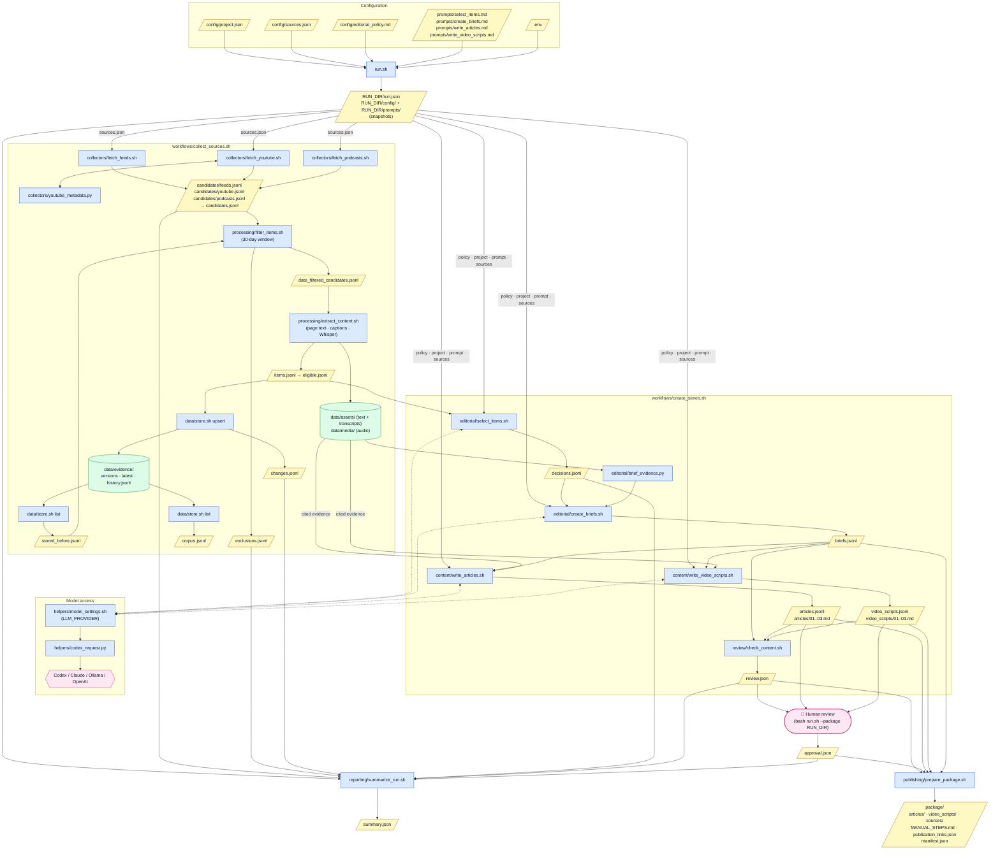

# Problem Set 4 Student Submission

> Course instructions are in [README.md](README.md). Required contracts are in [ARCHITECTURE.md](ARCHITECTURE.md).


| **Student** | Erin Tumulty |
| **GitHub repository** | (https://etumulty2020.github.io/PS04/)|


---

# Topic and Audience

| Field | Details |
| --- | --- |
| **Publication name** | The Road to Mammoth |
| **Topic** | Non-firearm gear for the Mammoth Sniper Challenge, comparing manufacturer claims against independent reviewers and practitioner experience |
| **Audience and assumed knowledge** | Prospective Mammoth competitors who already shoot precision rifle recreationally and know basic gear terminology, but haven't yet competed in a multi-day team endurance event where all gear is carried on foot |
| **Central question** | Would this gear be good, required, or effective at Mammoth? What do independent tests and field experience show, and what tradeoffs should competitors consider? |
| **Scope** | Spotting and measuring gear · shooting support · rucking and endurance gear · clothing and protection · weather and survival gear |
| **Exclusions** | Firearms, ammunition, chassis, and stocks · gunsmithing · suppressors and NFA items · reloading · sales and deals posts · purchase or affiliate links |
| **Reason for readers to return** | User should return to this channel so they remain knowledgable on recently released products and gear as they prepare to compete at the Mammoth Sniper Challenge. The preparation for one of these competitions takes months and many reviews and tests should be eveluated before a competitor arrives to the competition. |

---

# Published Series

All three pieces come from run [`run-20261016T010643Z`](runs/run-20261016T010643Z/). 

| Piece | Question | Title | Substack article | YouTube video |
| --- | --- | --- | --- | --- |
| 01 | What changed? | New Field Evidence Makes the Carry System Worth Revisiting | Add link | Add link |
| 02 | What holds up? | What Holds Up: Performance Claims Stop at the Conditions Tested | Add link | Add link |
| 03 | What should readers do? | Rehearse the Load You Actually Plan to Carry | Add link | Add link |

**Separate technical demonstration video:** Add link

---

# Setup and Execution

Document the required tools and versions, installation commands, model or provider choices, and configuration steps. List credential environment variable names without including secret values. Explain how to populate the project configuration, source list, editorial policy, and prompts.

After implementation, the required entry commands are:

```bash
bash run.sh
bash run.sh --package runs/RUN_ID
```


### Required tools


| Tool | Version tested | Install | Used for |
| --- | --- | --- | --- |
| bash | 3.2.57 | Built into macOS | Every pipeline component |
| jq | 1.7.1 | `brew install jq` | JSON/JSONL handling |
| curl | 8.7.1 | Built into macOS | Feeds, pages, podcasts, OpenAI-compatible requests |
| Python 3 | 3.13.3 | `brew install python@3.13` | Embedded parsing, evidence helpers, model adapter |
| yt-dlp | 2026.08.19 | `brew install yt-dlp` | YouTube discovery, captions, audio |
| ffmpeg | 9.0.2 | `brew install ffmpeg` | Audio conversion before transcription |
| mlx-whisper | 0.4.3 | `python3 -m pip install mlx-whisper` | Local transcription (`mlx-community/whisper-large-v3-turbo`) |
| Codex CLI | 0.161.0 | `brew install codex` or `npm install -g @openai/codex` | Default model provider |
| Claude Code | (your installed version) | See Claude Code docs | Model provider used for the final run |
| shasum | Built in | Built into macOS | Content hashes used as version IDs |
| git | 2.50.1 | Built into macOS (Xcode tools) | Version control |


### Populating the configuration

`run.sh` validates these files before collecting anything. It then copies them into `RUN_DIR/config/` and `RUN_DIR/prompts/`, and the stages read those copies, so an edit only affects later runs.

| File | What to put in it | Notes |
| --- | --- | --- |
| [config/project.json](config/project.json) | `publication_name`, `topic`, `audience`, `central_question` (all non-empty strings) | The topic text defines scope and exclusions; the audience text sets assumed knowledge |
| [config/sources.json](config/sources.json) | Array of `{source_id, publisher_id, kind, url}`; `kind` is `feed`, `youtube`, or `podcast` | Optional `perspective` and `notes` fields record independence, affiliates, and sponsor ties |
| [config/editorial_policy.md](config/editorial_policy.md) | Rules for relevance, official requirements, credibility, commercial incentives, freshness, perspectives, uncertainty, conflicts, exclusions, and accept/reject/defer | First draft kept in [editorial_policy_v0.md](config/editorial_policy_v0.md) |
| [prompts/select_items.md](prompts/select_items.md) | One accept/reject/defer decision per item, with reasons naming policy rules | Returns JSON Lines |
| [prompts/create_briefs.md](prompts/create_briefs.md) | Three distinct arguments; every claim linked to an item, a version, and a passage or timestamp | |
| [prompts/write_articles.md](prompts/write_articles.md) | Turns a brief into a Substack article for the audience | |
| [prompts/write_video_scripts.md](prompts/write_video_scripts.md) | Turns the same brief into a narrated script with visual and on-screen-text cues | |

The policy and project brief are attached after each prompt at run time, so the prompts point to the policy instead of repeating it.

**Sources at a glance (26 sources, 23 independent publishers):**

| Kind | Count | Sources |
| --- | --- | --- |
| Feed | 8 | Ruck Authority, Treeline Review, Rokslide, Kit Badger, Soldier Systems, SSUSA (NRA), AccurateShooter, Precision Rifle Blog |
| YouTube | 11 | Ruck Authority, GORUCK, Eberlestock, Longshot Tactical, Eastmans, Vortex, Gatorz, Mountain Smullets, Truth Then Freedom, Cold Harbour Supply, HuntFishShoot |
| Podcast | 7 | Vortex Nation, Rokcast, Hunt Backcountry (Exo), Backcountry Hunting Podcast, Valley to Peak Nutrition, Wolf, PRS |


---

# Architecture and Manual Handoffs

### Pipeline



**Legend:** 🟦 script · 🟨 input/output file · 🟩 persistent evidence store · 🟪 human step or model. Dotted arrows are model calls. All files without a folder prefix live in `runs/RUN_ID/`.


**Additional components and helpers:**

| File | Purpose |
| --- | --- |
| [helpers/model_settings.sh](helpers/model_settings.sh) | Shared provider switch (`LLM_PROVIDER`) loaded by the four AI stages |
| [helpers/codex_request.py](helpers/codex_request.py) | Sends a prompt to `codex exec` or `claude -p` and returns an OpenAI-compatible reply |
| [collectors/youtube_metadata.py](collectors/youtube_metadata.py) | Normalizes yt-dlp metadata for the YouTube fallback, without inventing publication dates |
| [editorial/brief_evidence.py](editorial/brief_evidence.py) | Builds bounded, verbatim evidence excerpts from accepted items for brief planning |

### Manual handoffs


| Step | Instructions | 
| --- | --- |
| Human editorial review | Review generated articles and video transcripts. Either make changes or approve.  | 
| Video production  | Using Google Vids take each generated video scene transcription and post into description. Insert each generated scene into one video and download.  | 
| YouTube publishing | I do not have a Youtube account so I have published my videos to a website hosted by GitHub instead.| YouTube links |
| Substack publishing | I do not have a Substack account so I have published the generated articles to a website hosted by GitHub. The artciles on the website have been given back to Codex to reformat them. | Substack links |

---
# Evidence and Runs

Each AI stage (`select_items`, `create_briefs`, `write_articles`, `write_video_scripts`) loads [helpers/model_settings.sh](helpers/model_settings.sh). That file reads `LLM_PROVIDER` and sends the stage's prompt to the chosen backend. Each stage still does its own parsing, validation, and receipt writing. I had to switch between different LLM providers and models because of credit limits. On both Codex and Claude I frequently only completed one run before hitting credit limits in initial stages. The valid inputs to `LLM_PROVIDER` are codex (default), claude, ollama (on local machine), and openai (use an API). 


**Models actually used** (from the stage receipts in each run's `logs/` folder):

| Run | Stage | Provider | Model | Outcome |
| --- | --- | --- | --- | --- |
| `041643Z`, `121456Z` | select_items, create_briefs | Codex | Codex default | Selection completed; briefs returned nothing (`needs_repair`) |
| `135930Z` (1st attempt) | select_items, create_briefs | Codex | Codex default | Selection decided 81 of 185 items (`incomplete`); briefs empty |
| `135930Z` (rerun) | select_items | Claude Code | `claude-haiku-5-5` | Completed: 185 of 185 decisions |
| `135930Z` (rerun) | create_briefs | Claude Code | `claude-haiku-5-5` | `needs_repair`: piece 01 cited only 1 publisher; one claim cited an unaccepted item |
| `135930Z` (rerun) | create_briefs | Claude Code | `claude-sonnet-5-5` | Completed: 3 briefs passed all evidence checks |
| `135930Z` | write_articles, write_video_scripts | Claude Code | `claude-sonnet-5-5` | Completed: 3 articles, 3 scripts |
| `010643Z` | select_items, create_briefs, write_articles, write_video_scripts | Codex | Codex default | Completed: 192 of 192 decisions, 3 briefs, 3 articles, 3 scripts |
| All runs | transcription | Local | `mlx-community/whisper-large-v3-turbo` | — |


### Runs


| Run | Actual date (UTC) | Run artifacts and logs | Elapsed time | Approximate cost | Result |
| --- | --- | --- | --- | --- | --- |
| 1 | 2026-10-14 21:08 | [run-20261014T210847Z](runs/run-20261014T210847Z/) | 12 s | $0 | Stopped after date filtering (385 discovered, nothing stored) |
| 2 | 2026-10-15 01:02 | [run-20261015T010202Z](runs/run-20261015T010202Z/) | 58 min | $0 | YouTube collection failed; 152 items stored, all new |
| 3 | 2026-10-15 04:16 | [run-20261015T041643Z](runs/run-20261015T041643Z/) | 47 min | Unknown (Codex) | 34 accepted; briefs empty |
| 4 | 2026-10-15 12:14 | [run-20261015T121456Z](runs/run-20261015T121456Z/) | 56 min | Unknown (Codex) | YouTube recovered; 41 accepted; briefs empty |
| 5 | 2026-10-15 13:59 | [run-20261015T135930Z](runs/run-20261015T135930Z/) | 3 h 2 min* | Unknown (Codex + Claude sign-ins) | `ready_for_production`; 8 accepted, 3 articles, 3 scripts |
| 6 **(final)** | 2026-10-16 01:06 | [run-20261016T010643Z](runs/run-20261016T010643Z/) | 1 h 9 min† | Unknown (Codex) | `ready_for_production`; 48 accepted, 3 articles, 3 scripts |


**Costs:** collection, extraction, and local Whisper cost $0. Model calls went through the Codex (ChatGPT) and Claude Code sign-ins, which don't report token usage, so their cost is recorded as unknown, not zero (`unknown_cost_stages` in each `summary.json`).

### What changed between runs

| Run | New | Changed | Unchanged | Notes |
| --- | --- | --- | --- | --- |
| 2 | 152 | 0 | 0 | First items stored |
| 3 | 2 | 9 | 143 | |
| 4 | 28 | 84 | 70 | YouTube collection recovered |
| 5 | 3 | 27 | 155 | Policy revised; selection model changed from Codex to Claude |
| 6 | 10 | 67 | 115 | Policy unchanged (v2); all model stages back on Codex; video-script prompt revised |


### Claim trace

| Step | Record |
| --- | --- |
| Published claim | Article 02: *"Rokslide's reviewer reports giving the Tract Toric rangefinding binocular a ten-hour freezer soak with its battery removed, then describes the display operating after removal."* ([articles/02.md](runs/run-20261016T010643Z/articles/02.md)) |
| Brief | Claim `02-c2` in [briefs.jsonl](runs/run-20261016T010643Z/briefs.jsonl), type `source_claim` |
| Editorial decision | **Accept**, pieces 01, 02, 03: *"newly reported testing includes a 2 lb. 5.5 oz. measured weight, a battery-out freezer soak, rain and fog ranging limitations … Rokslide is ad supported … findings remain attributed to this reviewer, and long-term durability … remain[s] unestablished."* |
| Source version | Rokslide, "Tract Toric LRF Rangefinding Binocular Review", `version_id 220ed6eb…3d2a2` |
| Exact passage | *"I did a 10-hour cold soak in the freezer with the battery removed."* … *"Of course, like any frozen optic, it did not take long for the exterior lenses to ice over in the warmer air, naturally interfering with observation and ranging, but I could see the display operating within the right barrel."* ([text file](data/assets/feed/84c5dc24e00b02f993e63be0aa461512/220ed6eb0893442944fab61d7dad5202a7be74c9abe5e6d3b342f9fc0db3d2a2.txt)) |

---

## Editorial Review

**Policy and prompts used:** [config/editorial_policy.md](config/editorial_policy.md) · [prompts/](prompts/) 

**Run 6 decisions:** 48 accepted · 121 rejected · 23 deferred (192 items).

The AI's decisions and reasons below are from [decisions.jsonl](runs/run-20261016T010643Z/decisions.jsonl). Overall the LLM interpreted my editorial policy correctly (and I dont disagree with any of the decisions it chose to make) however it sometimes followed it too well. I dont think the consumer considerations were well represented in the editorial policy as it focused primarily on verifying indepent test results. The nature of consumer products reviews is more opinion based and not test result driven. In future updates to my editorial code I would give more weight to the independent reviewer's experience with the product rather than their rigid test results.  

| Item | AI decision | AI reason (summary) | My judgment |
| --- | --- | --- | --- |
| Rokslide: Tract Toric LRF Rangefinding Binocular Review | Accept (01, 02, 03) | Measured weight (2 lb 5.5 oz), battery-out freezer soak, rain and fog ranging limits, comparative optics and ballistic checks; ad supported, single reviewer | Agree, this source had well documented testing done by the independent reviewer | |
| Rokslide: KUIU Icon 6 3500 Backpack Review | Accept (01, 02, 03) | Three packs compared on the same 1.2-mile, 510 ft loop with 28 and 92 lb loads; configured pack weighed at 5 lb 12.5 oz; single reviewer | Agree, this source had well documented testing done by the independent reviewer | |
| Treeline: REI Co-op Magma 30 Sleeping Bag Review | Accept (01, 02, 03) | Two-year review, 24+ nights at 33–54°F and in damp weather; affiliate funded; doesn't establish colder Mammoth conditions | Agree, even though it doesn't establish colde Mammoth conditions it could still be useful to a user. Potential improvement here would be to ask my LLM to forecast the weather conditions for this year's Mammoth. | |
| Mountain Smullets: The New Element Seeker In Action! | Accept (03) | Rangefinder and ballistic-output demo (~655 yd, wind call vs. observed mirage); one practitioner, possible Element relationship unverified | Agree, less robust testing but still valid | |
| Ruck Authority: Injinji Toe Socks for Rucking | Defer | Foot care transfers to Mammoth, but no wear trials, distances, or user experiences; affiliate commissions and GORUCK review units | Agree, insufficient testing | |
| AccurateShooter: BargainFinder 577 Deals of the Week | Reject | Deals roundup, excluded by Relevance; Amazon affiliate commissions and retailer promotions | Disagree. I had initially told my editorial policy to exclude company promotions and deals because they didn't demonstrate verified/tested results of the product. Upon review I'm now think that a potential competitor may actually be interested in sales and deals of certain products. Potential improvement: let the promotional sales through in the editorial policy but only recommend the products that have been independently tested.  | |

### Policy revisions

| Version | File | Used by |
| --- | --- | --- |
| v0 (first notes) | [editorial_policy_v0.md](config/editorial_policy_v0.md) | Not used in a run (rewritten before run 1) |
| v1 | [run-20261015T121456Z/config/editorial_policy.md](runs/run-20261015T121456Z/config/editorial_policy.md) | Runs 1–4 |
| v2 (current) | [config/editorial_policy.md](config/editorial_policy.md) | Runs 5–6 |

**v0 → v1:** rewrote the bullet notes as the editor's rules. The main substantive changes:


**v1 → v2 (between runs 4 and 5):** treated Mammoth's official page as the authority on required gear, and replaced packing-list verdicts with suitability questions. The main substantive changes:


⚠️ Run 5 also switched the selection model from Codex to Claude Haiku, so the drop in acceptances can't be attributed to the policy change alone.


# Reflection

| Topic | Details |
| --- | --- |
| Remaining limitations | I had initially excluded any content directly from the Mammoth Sniper Challenge and any sponsoring companies as evidence supporting a claim however by excluding them the video transcripts and articles strayed from the central questions. The generated media turned into more of a review of gear in general rather than a critical comparison of gear appropriate for Mammoth. In the future I would re-configure the sources to pull the specs of a piece of equipment and then require the reviewing source specifically discuss the exact product claims with their own experiences at Mammoth. I would probably need to include more sources since the availability of this specific content is limited. However to include more sources would require more token credits to determine relevance of the transcribed sources.  
| "Changed" counts are inflated | None of the 67 "changed" items in run 6 had a real content change; the version fingerprint covers the whole page, so rotating sidebars, related-post lists, and transcript timestamps register as revisions. In the future I would either increase the editorial policy to detecte this "false positive" or change the fetch file. |
| Credit limit Challenge | Increasing the configured sources, updating the editorial prompt all increase the character count given to the chose LLM. This increased character count in addition to all the transcribed sources material (podcast, youtube videos, feeds) and exceeded the credit limit in Codex. This is why I had to switch to Claude at one point and then wait for credits to switch back to Codex, use batches when making LLM calls, and use less sophisticated model versions. |
| Too many sources vs. evidential threshold | For this particular audience, potential Mammoth Sniper Challenge competitors, not enough evidence was available to pass evidence checks. The primary piece of gear to get past the evidence check was the backpacks but no scopes, range finders, clothes etc. items had significant evidence. This is why the Google videos primarily focus on the differnet backpacks. In the future I would either increase the source material (see credit limit challenge) or loosen the editorial requirements. |
| Google Vids character limit affected video quality | After all the post processing of the collected sources (see credit limit challenge), Google vids enforced a 2500 character limit for video descriptions. This lead to very poor video quality that did not clearly deliver the argument to the central quesions to the viewer.|

---


